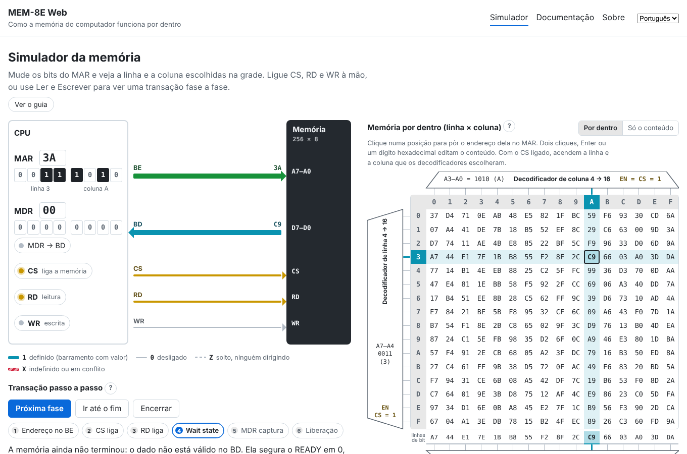

# MEM-8E Web

Simulador educacional que mostra, por dentro, como funciona a memória do
computador, no navegador, em português e inglês.

Coloque um endereço no barramento de endereços e veja os decodificadores de
linha e de coluna escolherem uma posição entre 256, o dado chegar ao barramento
de dados e os sinais de controle (CS, RD, WR) e de tempo trabalharem juntos.

É um projeto irmão do [CPU-8E Web](https://github.com/tropical-yetti/cpu-8e-web):
a memória tem a mesma arquitetura de 8 bits e os mesmos nomes (MAR, MDR, BE, BD)
da CPU-8E, mas aqui ela deixa de ser uma caixa-preta.

**Use no navegador:** <https://tropical-yetti.github.io/mem-8e-web/> (em
construção)



## O que dá para fazer

- **Mudar o endereço** no MAR, bit a bit, e ver a linha e a coluna escolhidas na matriz 16 × 16.
- **Ligar CS, RD e WR à mão**, inclusive em combinações erradas, e ver o barramento de dados solto (Z) ou em conflito (X).
- **Ler e escrever fase a fase**, com a explicação de cada fase.
- **Ver a memória por dentro**: decodificadores, linhas de bit, seletor de coluna e buffers de saída.
- **Ver em portas lógicas** um bit da memória e os decodificadores 4 → 16.
- **Comparar o ciclo de memória com o da CPU** no diagrama de tempo, com wait states.
- **Editar a memória** pela grade, com o mouse ou o teclado.
- **Guardar e compartilhar a memória** num arquivo de texto, com endereço e bytes em hex, ou colando e copiando o mesmo texto.

Na primeira visita, um guia com balões apresenta cada parte da tela. A
[documentação](https://tropical-yetti.github.io/mem-8e-web/#/documentacao),
dentro do site, explica como a memória funciona e traz um roteiro de aula com
exercícios. Veja também o [plano do projeto](docs/PLANO.md) e as
[decisões de arquitetura](docs/adr/).

## Desenvolvimento

Requer Node.js 22.

```sh
npm install
npm run dev        # servidor local
npm test           # testes
npm run build      # versão de produção em dist/
```

Veja [CONTRIBUTING.md](CONTRIBUTING.md) para as regras do projeto.

## Licença

[GPL-3.0-or-later](LICENSE). Autoria e créditos em [NOTICE.md](NOTICE.md).
