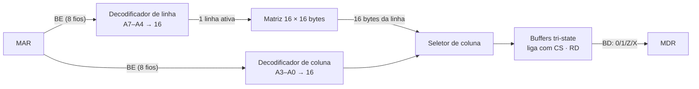

# 0001 — Modelo funcional por bloco, com sinais de 4 valores

- **Data:** 2026-10-21
- **Proponente:** Ansone (redação com o Claude)
- **Estado:** Proposta
- **Discussão:** [#2](https://github.com/tropical-yetti/mem-8e-web/issues/2)

## Contexto e motivação

O MEM-8E Web precisa mostrar o que acontece **dentro** da memória: o endereço
chega, um decodificador escolhe uma linha, outro escolhe uma coluna, e o dado
aparece no barramento de dados. O aluno também precisa ver situações de
erro, como dois circuitos dirigindo o barramento ao mesmo tempo (contenção) ou
o barramento solto (alta impedância).

O projeto prioriza **boa exibição e interatividade**, e não fidelidade
elétrica. Então o núcleo precisa ser pequeno e fácil de testar, mas ainda
produzir esses estados de verdade, sem que cada cenário seja desenhado à mão.

## Alternativas consideradas

1. **Simulador genérico de portas lógicas** (netlist com atraso unitário).
   Cada porta é simulada. Tudo o que aparece na tela, inclusive glitches,
   é consequência do circuito.
   Desvantagens: milhares de portas no modo 256 × 8, motor mais complexo e mais
   difícil de ler. O detalhe que ele permite vai além do que a tela consegue
   mostrar.
2. **Máquina de estados de animação.** Cada fase da leitura ou da escrita só
   acende partes do desenho.
   Desvantagens: nada é calculado. Contenção, alta impedância e leituras
   inválidas teriam de ser programadas caso a caso, e os experimentos "e se…?"
   viram roteiros fixos.
3. **Modelo funcional por bloco** (escolhida). Cada bloco (decodificador de
   linha, decodificador de coluna, matriz, seletor, buffers tri-state,
   barramento) é uma função pura das suas entradas. Os sinais têm quatro valores:
   `0`, `1`, `Z` (ninguém dirige) e `X` (conflito ou indefinido).

## Decisão

Usar o modelo funcional por bloco com sinais de 4 valores. O barramento resolve
quem o está dirigindo: nenhum dá `Z`, um dá o valor dele, dois com valores
diferentes dão `X`. O detalhe em portas lógicas (decodificador, célula de
1 bit) é desenhado a partir das entradas e saídas do bloco, sem simular cada
porta.

## Impactos

- **Código:** `src/core/nivel.ts` (sinais de 4 valores), `memoria.ts`
  (blocos) e `barramento.ts` (resolução de quem dirige). Nada em `src/core/`
  importa Vue ou o navegador.
- **Testes:** cada bloco tem testes de tabela, inclusive com `Z` e `X` nas
  entradas.
- **Usuário:** fios coloridos por nível; contenção aparece em vermelho, e
  barramento solto aparece tracejado.
- **Risco:** glitches de propagação (endereço mudando no meio da leitura) não
  surgem sozinhos. Eles serão tratados pelo modelo de tempo (ADR 0003), que diz
  **quando** a saída de cada bloco fica válida.
