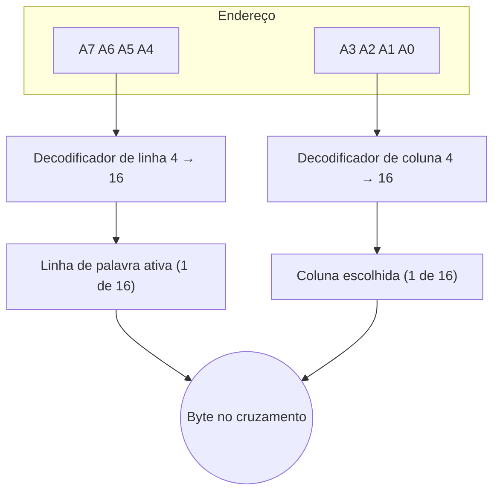

# 0002 — Memória 256 × 8 organizada em matriz 16 × 16

- **Data:** 2026-10-21
- **Proponente:** Ansone (redação com o Claude)
- **Estado:** Proposta
- **Discussão:** issue a abrir

## Contexto e motivação

A memória precisa ter o mesmo tamanho da CPU-8E (256 bytes, endereços
`00`–`FF`), para que os programas `.bin` do CPU-8E carreguem sem mudança.
Ao mesmo tempo, ela precisa caber na tela de um jeito que ensine **como**
um endereço escolhe uma posição.

## Alternativas consideradas

1. **Lista linear de 256 posições** com um decodificador 8 → 256.
   É simples de desenhar como tabela, mas esconde a organização real, e o
   decodificador (256 portas AND de 8 entradas) não cabe na tela de forma
   legível.
2. **Duas memórias**: uma pequena (16 × 4) para o nível de portas e a de
   256 × 8 para o uso normal. É mais didático no começo, mas duplica a
   interface e os testes.
3. **Uma memória 256 × 8 em matriz 16 × 16** (escolhida). Os 4 bits altos
   (A7–A4) escolhem a linha, e os 4 bits baixos (A3–A0) escolhem a coluna.

## Decisão

Uma única memória de 256 × 8 bits, desenhada como uma grade de 16 linhas por
16 colunas de bytes. Um endereço em hexadecimal se lê direto na grade: em
`3A`, o `3` é a linha e o `A` é a coluna.

## Impactos

- **Código:** a geometria (bits de linha e de coluna) fica em constantes do
  núcleo, e não espalhada pela interface.
- **Testes:** para cada um dos 256 endereços, exatamente uma linha e uma coluna
  ficam ativas.
- **Usuário:** editar um bit do MAR move a linha ou a coluna acesa na hora.
  Isso mostra a ligação entre o binário e a posição física.
- **Futuro:** a separação entre linha e coluna é a base dos modos síncronos
  (ADR 0003), em que a memória primeiro "abre" uma linha e depois lê
  colunas dela.
