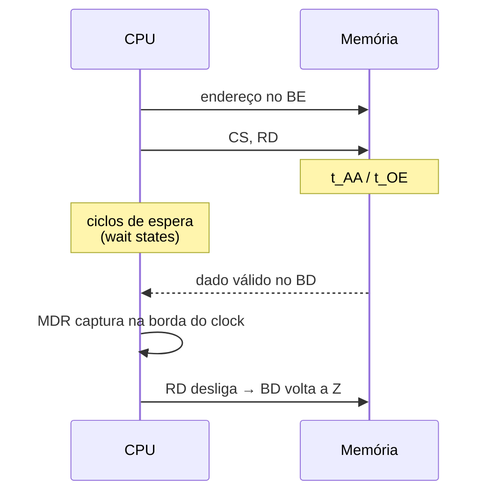

# 0003 — Modelo de tempo genérico e modos de memória abstratos

- **Data:** 2026-10-21
- **Proponente:** Ansone (redação com o Claude)
- **Estado:** Proposta
- **Discussão:** [#4](https://github.com/tropical-yetti/mem-8e-web/issues/4)

## Contexto e motivação

Um dos objetivos é mostrar que **o ciclo de memória não é o ciclo da CPU**: a
memória tem o próprio tempo de acesso, e uma CPU mais rápida precisa esperar
por ela. Também queremos, mais tarde, mostrar memórias síncronas e a ideia do
DDR.

A CPU-8E não se parece com uma CPU real (não tem cache nem rajadas, e acessa
um byte por vez). Copiar os tempos de um chip concreto (datasheet, padrão
JEDEC) traria detalhes que não conversam com ela e prenderia o projeto a uma
tecnologia específica.

## Alternativas consideradas

1. **Sem tempo:** leitura e escrita instantâneas, como no CPU-8E. Isso não
   mostra wait states nem leituras inválidas.
2. **Tempos de um chip real** (por exemplo, uma SRAM comercial ou DDR4). É
   realista, mas difícil de explicar, e não combina com a CPU-8E.
3. **Modelo genérico e didático** (escolhida). Poucos parâmetros com nomes
   claros e modos abstratos, sempre rotulados como didáticos.

## Decisão

O núcleo tem um modelo de tempo com parâmetros genéricos e uma linha do tempo
que guarda o valor de cada sinal ao longo da transação:

| Parâmetro    | Significado                                       |
| ------------ | ------------------------------------------------- |
| t_AA         | do endereço estável ao dado válido                |
| t_OE         | do RD ativo ao dado no barramento                 |
| t_WP         | largura mínima do pulso de escrita                |
| clock da CPU | período configurável; define quando o MDR captura |

Se a memória é mais lenta que o ciclo, entram **wait states**. Se o MDR
captura antes de o dado ficar válido, a leitura dá `X`.

Os modos de memória entram em fases:

| Modo                   | Ideia mostrada                                              | Quando  |
| ---------------------- | ----------------------------------------------------------- | ------- |
| Assíncrona (tipo SRAM) | sem clock; o tempo conta da mudança de endereço             | v1.0    |
| Síncrona (tipo SDRAM)  | clock próprio, latência em ciclos, abrir linha → ler coluna | pós-1.0 |
| DDR simplificada       | dado nas duas bordas do clock, rajada de bytes seguidos     | pós-1.0 |

## Impactos

- **Código:** `src/core/tempo.ts` desde a v1.0. Os modos futuros entram como
  novos modelos de tempo, sem mudar a interface do diagrama.
- **Testes:** capturar antes de t_AA dá leitura inválida; com wait states
  suficientes, a leitura fica correta.
- **Usuário:** o diagrama de tempo mostra o clock da CPU e os sinais da memória
  no mesmo eixo, e os wait states aparecem destacados.
- **Risco:** os valores não correspondem a nenhum chip real. A documentação deve
  dizer isso claramente.
