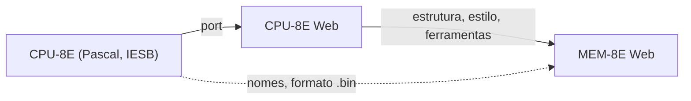

# 0004 — Reaproveitamento de código e estilo do CPU-8E Web

- **Data:** 2026-10-21
- **Proponente:** Ansone (redação com o Claude)
- **Estado:** Aceita (2026-10-21)
- **Discussão:** [#5](https://github.com/tropical-yetti/mem-8e-web/issues/5)

## Contexto e motivação

O MEM-8E Web é um projeto irmão do CPU-8E Web. Os dois devem parecer da mesma
família, e muito do que o CPU-8E Web já resolveu serve aqui: estrutura do site,
idiomas, tema claro e escuro, acessibilidade, CI e publicação.

Ao mesmo tempo, **não há código legado a reproduzir**. Não existe referência
em Pascal nem validação ciclo a ciclo. A memória não precisa ser compatível
com o CPU-8E além do formato dos programas.

## Alternativas consideradas

1. **Começar do zero:** liberdade total, mas mais trabalho e um visual diferente.
2. **Dependência compartilhada** (um pacote comum aos dois projetos): evita
   duplicação, mas exige publicar e versionar um pacote enquanto os dois
   projetos ainda mudam muito.
3. **Copiar e adaptar** o que servir, registrando a origem (escolhida).

## Decisão

Copiar e adaptar do CPU-8E Web:

- a pilha (Vue 3, Vite, TypeScript, Pinia, vue-router, vue-i18n) e as
  configurações (TypeScript estrito, ESLint, Prettier, Vitest, Playwright,
  axe, Lighthouse, checagem de licenças);
- a estrutura do site (cabeçalho, troca de idioma, rodapé, página Sobre), o
  estilo e as cores;
- a convenção do núcleo sem interface (`src/core/`) e das transações como
  geradores (`yield`) que emitem passos;
- mais tarde, a tabela de memória.

Do CPU-8E vêm só os **nomes** (MAR, MDR, BE, BD, RD, WR) e o formato `.bin`
de 256 bytes. Os sinais de controle que o CPU-8E abstrai (CS, RD, WR) aqui são
explícitos.

## Impactos

- **Licença:** GPL-3.0-or-later, como o CPU-8E Web. Um arquivo copiado de um
  arquivo do CPU-8E Web que **deriva do original** (por exemplo,
  `TabelaMemoria.vue`) leva no cabeçalho a origem e o copyright do CPU-8E
  original. O teste `tests/licenca.test.ts` verifica isso pela lista
  `DERIVADOS`.
- **Manutenção:** uma correção no estilo ou nas ferramentas de um projeto
  precisa ser levada ao outro manualmente.
- **Futuro:** se a duplicação crescer, a alternativa 2 pode ser revista numa
  nova ADR.
