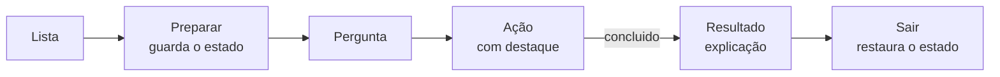

# 0005 — Experimentos "e se…?" guiados

- **Data:** 2026-10-22
- **Proponente:** Ansone (redação com o Claude)
- **Estado:** Aceita (2026-10-22)
- **Discussão:** [#30](https://github.com/tropical-yetti/mem-8e-web/issues/30)

## Contexto e motivação

Boa parte do que se aprende sobre a memória vem do que dá errado: dois lados
dirigindo o barramento ao mesmo tempo, um endereço que muda antes da hora, uma
CPU que não espera. O simulador já mostra quase tudo isso, mas só para quem
sabe montar a situação à mão, ligando CS, RD, WR e "MDR → BD" na ordem certa.

A 0.9 traz experimentos prontos: o simulador monta a situação, pergunta o que
o aluno espera, conduz os passos e explica o resultado. São cinco:

| Experimento              | O que se vê                                                      |
| ------------------------ | ---------------------------------------------------------------- |
| RD e WR juntos           | o resultado depende de quem dirige o BD (ver a decisão 2)        |
| Contenção no BD          | a CPU e a memória dirigem o BD; onde discordam, o bit vira **X** |
| Endereço trocado no meio | o dado no BD muda antes da captura; o MDR fica com outro byte    |
| CPU que não espera       | com a memória lenta e sem wait states, a leitura dá **X**        |
| CS desligado             | os decodificadores param, o BD fica solto (**Z**) e o MDR, em X  |

Dois desses casos pedem decisões no núcleo, porque hoje editar o MAR no meio
de uma transação a cancela, e porque o resultado de RD e WR juntos precisa ser
o que queremos ensinar.

## Alternativas consideradas

1. **Página de documentação com os passos:** o aluno lê e monta tudo à mão.
   Não precisa de código novo, mas o roteiro de aula já faz isso, e o aluno
   perde o fio facilmente.
2. **Vídeos ou animações gravadas:** bonito, mas não interativo, difícil de
   manter nos dois idiomas e fora do simulador.
3. **Experimentos dentro do simulador, descritos como dados** (escolhida).
   Reaproveitam o balão e o destaque do guia (0.7) e podem ser testados.

## Decisão

### 1. Experimentos como dados

Cada experimento é um objeto em `src/experimentos/`:

```ts
interface Experimento {
  id: string
  /** Põe o simulador na situação inicial (MAR, MDR, memória, sinais, tempo). */
  preparar(simulador: SimuladorStore): void
  passos: {
    /** O que destacar na tela (o mesmo `data-guia` do guia). */
    alvo?: string
    /** O passo termina sozinho quando isto fica verdadeiro. */
    concluido?(simulador: SimuladorStore): boolean
  }[]
}
```

Os textos (pergunta, passos, explicação) ficam nos arquivos de idioma, em
`experimentos.<id>`. Cada experimento segue três momentos: **pergunta** ("o
que você acha que vai acontecer?"), **ação** (com a parte da tela em
destaque) e **resultado** (a explicação aparece quando `concluido` detecta a
situação, por exemplo um X no BD).

- Um botão **Experimentos**, ao lado de "Rever o guia", abre a lista.
- Só um experimento (ou o guia) fica ativo por vez.
- Antes de preparar, o simulador guarda o estado. **Sair do experimento**
  devolve tudo como estava: memória, registradores, sinais e tempo.
- O balão do guia vira um componente comum ao guia e aos experimentos.



### 2. RD e WR juntos: o modelo atual fica

Com CS, RD e WR ligados, os buffers de saída põem a célula no BD, e o latch da
mesma célula copia o BD. O modelo atual não dá prioridade a nenhum dos dois, e
isso continua assim:

- **Sem a CPU dirigindo o BD**, a memória regrava o próprio valor. Nada muda
  na tela, e a pergunta "por que nada aconteceu?" é a lição.
- **Com "MDR → BD" ligado**, há contenção: onde o MDR e a célula discordam, o
  BD fica em X, e a célula guarda o X.

A alternativa seria dar prioridade ao WR no modelo, que é mais fiel a muitos
chips, mas esconderia o conflito que o experimento quer mostrar. Para não
ensinar algo diferente do que acontece fora do simulador, o resultado do
experimento e a página "Como a memória funciona" trazem uma observação sobre
memórias reais:

- em muitas SRAMs assíncronas, WR ativo desliga os buffers de saída, e o chip
  só escreve;
- o controlador de memória da CPU nunca liga RD e WR ao mesmo tempo, e esse é
  o jeito certo de evitar o conflito;
- o modelo didático não dá prioridade a nenhum dos dois justamente para que o
  conflito fique visível.

### 3. Mudar o MAR no meio de uma leitura não cancela mais a transação

Hoje, qualquer edição do MAR cancela a transação. Passa a ser assim:

- **Numa leitura**, a mudança do MAR fica valendo a partir da próxima fase:
  os decodificadores escolhem a nova célula, e o BD mostra o novo dado. O
  diagrama de tempo marca a mudança no BE.
- **Com o modelo de tempo**, a mudança recomeça a contagem de t_AA: o dado só
  fica válido t_AA depois da mudança. Se a captura vier antes, o MDR recebe X.
  A mudança conta como feita no início da fase seguinte.
- **Numa escrita**, mudar o MAR continua cancelando a transação. Mudar o
  endereço com WR ativo é outro tipo de erro, que pode virar um experimento
  depois.
- Editar o MDR ou os sinais continua cancelando, como hoje.

## Impactos

- No código: `src/experimentos/` (novo), `src/guia/` (balão comum),
  `src/stores/simulador.ts` (guardar e restaurar estado; MAR no meio da
  leitura), `src/core/tempo.ts` (t_AA a partir da última mudança de
  endereço), `src/components/DiagramaTempo.vue` (marca da mudança no BE).
- Nos testes: cada experimento tem um teste que prepara, segue os passos e
  confere o resultado esperado; o núcleo ganha testes da leitura com o MAR
  trocado, com e sem tempo; e2e e axe na lista e no balão.
- No usuário: o botão Experimentos e, numa leitura passo a passo, editar o MAR
  não cancela mais a transação.
- Riscos: o balão comum ao guia e aos experimentos pode complicar o guia; os
  testes da 0.7 ficam como estão para garantir que ele não muda.
