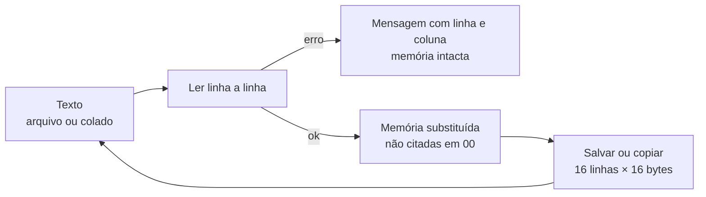

# 0006 — Conteúdo da memória em arquivo de texto

- **Data:** 2026-10-22
- **Proponente:** Ansone (redação com o Claude)
- **Estado:** Proposta
- **Discussão:** [#31](https://github.com/tropical-yetti/mem-8e-web/issues/31)

## Contexto e motivação

O plano previa carregar e salvar a memória no formato `.bin` do CPU-8E, e a
ADR 0004 citava o formato dos programas como o único ponto de compatibilidade
com o CPU-8E. Na prática, arquivos binários atrapalham:

- não dá para abrir, ler nem corrigir um `.bin` num editor comum;
- o aluno não consegue escrever um à mão nem colar um num e-mail ou num
  roteiro de aula;
- um `.bin` do CPU-8E é um **programa**. Carregá-lo aqui só preenche bytes,
  sem executar nada, e isso pode confundir quem vem do CPU-8E. Avisar isso
  direito exigiria o núcleo do CPU-8E Web simulando a execução, o que está
  fora do escopo.

Esta ADR substitui o ponto da ADR 0004 sobre o formato dos programas: o
MEM-8E Web não precisa ser compatível com o CPU-8E em nada.

## Alternativas consideradas

1. **`.bin` do CPU-8E** (o plano original): compatível, mas tem os problemas
   acima.
2. **JSON:** fácil de ler no código, mas cheio de aspas e chaves para quem
   escreve à mão, e ruim para mostrar uma matriz de bytes.
3. **Formatos de gravadores (Intel HEX, S-record):** padrões reais, mas com
   somas de verificação e registros que não ajudam a aprender sobre a memória.
4. **Texto simples, com endereço e bytes em hex** (escolhida). Parece um
   _dump_ de memória, cabe na tela e dá para escrever à mão.

## Decisão

Um arquivo de texto (`.txt`, UTF-8) com a memória em hexadecimal:

```text
# MEM-8E Web: conteúdo da memória (256 × 8)
# salvo em 2026-10-22, versão 0.9.0

00: 3A 10 C4 FF 00 00 00 00 00 00 00 00 00 00 00 00
10: 2A XX 00 00 00 00 00 00 00 00 00 00 00 00 00 00
; uma linha sem endereço continua de onde a anterior parou
01 02 03
F0: 1X0X0001
```

- **Comentários:** de `#` ou `;` até o fim da linha. Linhas vazias são
  ignoradas.
- **Endereço:** opcional, em hex, seguido de `:` (`F0:`). Sem endereço, os
  bytes continuam a partir do último lido. O primeiro byte sem endereço vai
  para `00`.
- **Bytes:** separados por espaço. Cada um pode ser:
  - **2 dígitos hex** (`3A`), em maiúsculas ou minúsculas;
  - **`XX`**, uma célula com os 8 bits indefinidos;
  - **8 dígitos `0`, `1` ou `X`** (`1X0X0001`), para uma célula com só alguns
    bits indefinidos.
- **Carregar substitui a memória inteira.** As posições que o arquivo não
  cita ficam em `00`, e a mensagem diz quantas posições vieram do arquivo.
- **Erros não mudam nada.** Um byte inválido, um endereço depois de `FF` ou
  um endereço repetido cancelam o carregamento, e a mensagem diz a linha e a
  coluna do problema.
- **Salvar** escreve as 256 posições em 16 linhas de 16 bytes, com endereço,
  e um comentário com a data e a versão. O arquivo salvo carrega de volta sem
  perder nada, inclusive os X.
- Além do arquivo, uma janela **Colar texto** aceita o mesmo formato, e uma
  opção **Copiar** põe o conteúdo atual na área de transferência. Isso ajuda
  no celular, onde abrir e salvar arquivos é mais difícil.
- Só a memória entra no arquivo. MAR, MDR, sinais e tempo ficam de fora.



A compatibilidade com `.bin` e `.asm` do CPU-8E fica como ideia para depois,
junto com a integração com o CPU-8E Web, quando fizer sentido mostrar que o
programa também é executado.

## Impactos

- No código: `src/core/arquivo.ts` (novo: ler e escrever o texto, sem
  depender da tela), `src/stores/simulador.ts` (carregar de níveis, não só de
  bytes) e um componente com os botões Abrir, Salvar, Colar e Copiar.
- Nos testes: salvar e carregar de volta dá a mesma memória, inclusive com X;
  cada tipo de erro aponta a linha e a coluna certas e não muda a memória; e2e
  para abrir, salvar e colar, com axe.
- No usuário: a memória pode ser guardada, compartilhada e escrita à mão. Os
  arquivos `.bin` do CPU-8E não abrem aqui.
- Riscos: um formato próprio precisa de documentação; ele ganha uma seção nas
  páginas "Primeiros passos" e "Roteiro".
