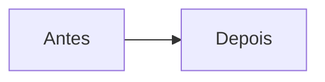

# NNNN — Título curto da decisão

- **Data:** AAAA-MM-DD
- **Proponente:** nome
- **Estado:** Proposta | Aceita | Rejeitada | Substituída por NNNN
- **Discussão:** link da issue

## Contexto e motivação

Qual problema esta decisão resolve? O que nos obriga a decidir agora?

## Alternativas consideradas

1. **Alternativa A:** como seria, vantagens e desvantagens.
2. **Alternativa B:** como seria, vantagens e desvantagens.

## Decisão

O que foi escolhido, em uma ou duas frases, e por quê.

## Impactos

- No código: quais pastas e módulos mudam.
- Nos testes: o que passa a ser verificado.
- No usuário: o que ele vê de diferente.
- Riscos e o que fica mais difícil depois.
